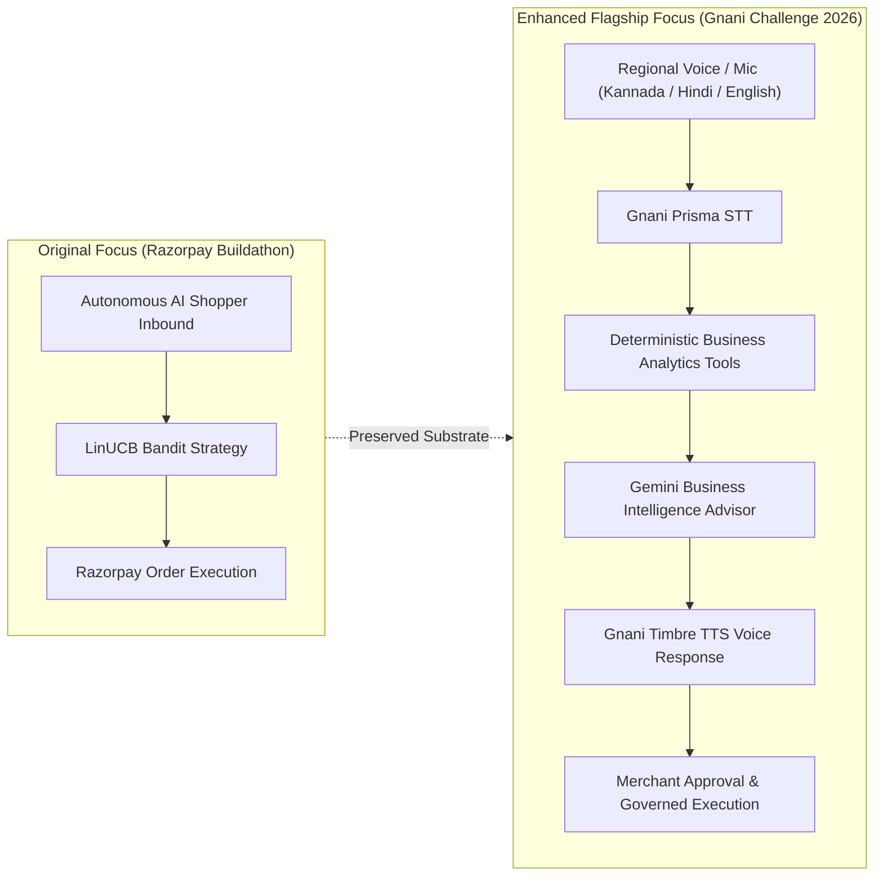
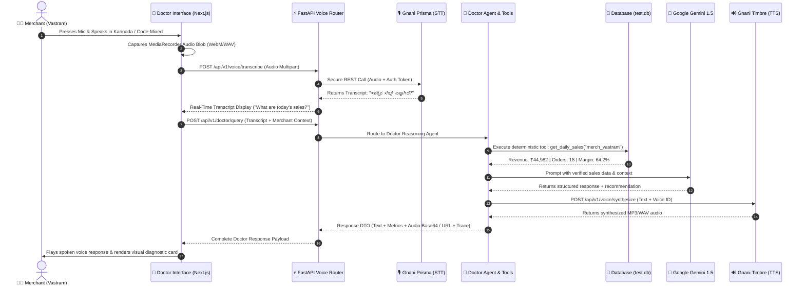

# 🏛️ Vyapar Mitra — Architecture Analysis & Enhancement Blueprint
**Challenge**: The Great Indian AI Internship Challenge 2026 (Gnani AI)  
**Document**: Architecture Analysis & Subsystem Specifications  
**Author**: Senior Full-Stack Architect & Voice AI Lead  

---

## 1. Architectural Evolution: From Buildathon to Gnani AI 2026

The original repository was constructed around an autonomous pricing and bundling transaction loop. To satisfy the Gnani AI Internship Challenge 2026, the architecture must transition from an **autonomous procurement responder** into a **multilingual AI business growth agent and voice advisor for independent retailers (Vyapar Mitra)**.

---

## 2. Four-Plane Architecture Specification

The system maintains four decoupled, isolated architectural planes:

### Plane 1: Conversational Voice & Channel Ingestion Plane
- **Browser Audio Capture**: Captures 16kHz PCM / WebM Opus microphone stream with real-time audio level monitoring.
- **Gnani Prisma Speech-to-Text**: Converts regional merchant speech (Kannada `kn-IN`, Hindi `hi-IN`, Code-Mixed, English `en-IN`) into clean text transcripts.
- **Gnani Timbre Text-to-Speech**: Synthesizes verified business diagnoses and strategic recommendations into natural Indian regional spoken voice.
- **WhatsApp Web Connector & Meta Cloud API**: Ingests merchant voice memos and text messages over WhatsApp for on-the-go business status.

### Plane 2: Deterministic Business Reasoning & Tool Substrate (Python Backend)
**Foundational Rule**: *The LLM never calculates financial metrics. Deterministic code calculates; the LLM interprets.*
The backend exposes a controlled registry of deterministic tools:
- `get_daily_sales(merchant_id, date)`: Exact revenue, order count, AOV, and top SKUs from verified database transactions.
- `get_profit_summary(merchant_id, timeframe)`: Gross revenue minus wholesale COGS, gross margin percent.
- `get_inventory_health(merchant_id)`: Slow-moving SKUs, stockout velocity (<8h), dead stock holding costs.
- `get_channel_performance(merchant_id)`: WhatsApp Direct vs D2C Web vs Amazon vs Flipkart net contribution after platform fees and commissions.
- `simulate_price_change(product_id, target_price)`: Elasticity check and projected monthly margin delta.
- `generate_bundle_offer(primary_sku, secondary_sku, discount_percent)`: Liquidity release bundle simulation.

### Plane 3: Gemini Business Reasoning Engine
- **Role**: Interprets structured JSON responses returned by the deterministic tools.
- **Context Injection**: Merchant identity, category benchmark, policy constraints (margin floor $\ge 25\%$), and conversation history.
- **Output Formats**:
  - `conversational_reply`: Crisp, empathetic summary tailored for spoken delivery (2–3 sentences max).
  - `detailed_analysis`: Structured bullet points with metrics, evidence rows, and clear reasoning.
  - `recommended_actions`: Governed action proposal ready for merchant one-click approval.

### Plane 4: Merchant Governance, Action Lifecycle & Audit Ledger
- **Action State Machine**:
  $$\text{PROPOSED} \longrightarrow \text{VALIDATED} \longrightarrow \text{WAITING\_FOR\_APPROVAL} \longrightarrow \text{APPROVED} \longrightarrow \text{EXECUTED} \longrightarrow \text{VERIFIED}$$
- **Rejection & Cancellation**: Actions can transition to `REJECTED`, `CANCELLED`, or `FAILED` at any gate.
- **Append-Only Immutability**: All decisions, approvals, and executions write an immutable record to `audit_events`.

---

## 3. End-to-End Voice Doctor Sequence Diagram

---

## 4. Separation of Concerns: LLM vs Deterministic Code

| Functionality | Responsible Engine | Rationale |
| :--- | :--- | :--- |
| **Today's Revenue & Orders** | Backend SQL Aggregator | LLMs hallucinate numbers; financial totals must reconcile to ₹0.01 precision. |
| **Gross Margin & Contribution** | Backend Financial Logic | Margin = $(P - C) / P$; strict math requirement. |
| **Stock Depletion Velocity** | Backend Analytics | Depletion rate based on historical order frequency and lead time. |
| **Marketplace Fee Deductions** | Backend Matrix | Amazon 18%, Flipkart 15%, Meesho 8%, WhatsApp 0%. |
| **Intent Recognition** | Gemini / RegEx NLU | Maps spoken merchant phrasing to structured tool calls. |
| **Explaining "Why"** | Gemini LLM | Translates dry financial metrics into actionable, empathetic merchant advice. |
| **Speech-to-Text** | Gnani Prisma | Purpose-built for Indian regional languages and accents. |
| **Text-to-Speech** | Gnani Timbre | High-fidelity Indian English, Hindi, and Kannada voice synthesis. |

---

## 5. Architectural Invariants to Preserve

1. **Zero Financial Hallucination**: No metric displayed in the Doctor voice response may be generated ex-nihilo by an LLM prompt. Every financial number must trace back to an executed database record or verified deterministic formula.
2. **Atomic Policy Validation**: No commercial price modification or bundle blast may execute without passing through `PolicySafetyValidator` (Gross Margin $\ge 25\%$, Discount $\le 20\%$).
3. **Graceful Degradation**: If Gnani API or Gemini API experiences network timeouts or quota exhaustion, the system must cleanly degrade to deterministic mock/rule-based responses without breaking the UI.
4. **Tenant Isolation**: All database queries must be filtered by `merchant_id` to prevent cross-tenant data leakage.

