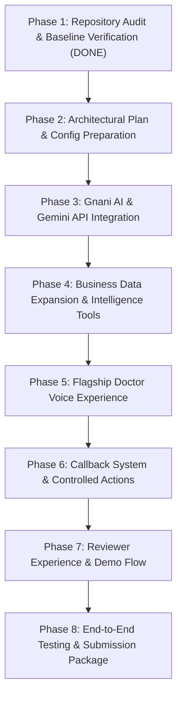

# 🚀 Vyapar Mitra — Implementation Roadmap & Execution Plan
**Competition**: The Great Indian AI Internship Challenge 2026 (Gnani AI)  
**Submission Deadline**: November 10, 2026, 11:59 PM IST  
**Document**: Step-by-Step Implementation Roadmap  
**Team**: Bhuvan Gowda H K & Dhanush A G  

---

## 1. Roadmap Overview & Execution Timeline

---

## 2. Phase-by-Phase Task Breakdown

### Phase 1: Complete Repository Audit (COMPLETED)
- [x] Comprehensive code scan of frontend, backend, database models, and connectors.
- [x] Identified existing LinUCB bandit engine, Razorpay test mode, and immutable audit logs.
- [x] Produced `PROJECT_AUDIT.md`, `ARCHITECTURE_ANALYSIS.md`, `FEATURE_STATUS.md`, and `INTEGRATION_GAP_REPORT.md`.

### Phase 2: Configuration Preparation & Safety Invariants
- [ ] Add standardized environment variables in `.env.example` for Gnani (`GNANI_API_KEY`, `GNANI_BASE_URL`, `GNANI_STT_ENDPOINT`, `GNANI_TTS_ENDPOINT`, `GNANI_STT_LANG`, `GNANI_TTS_VOICE`) and Gemini (`GEMINI_API_KEY`, `GEMINI_MODEL`).
- [ ] Add circuit breaker and developer test mode fixtures (`GNANI_USE_LOCAL_MOCK=true`) to safeguard the 5,000 credit budget.
- [ ] Verify database migration and session handling for new models.

### Phase 3: Gnani AI (Prisma STT + Timbre TTS) & Gemini Integration
- [ ] Create `services/voice/gnani_stt_client.py`: Async client handling audio multipart uploads, language configuration (`kn-IN`, `hi-IN`, `en-IN`), error retries, and latency tracking.
- [ ] Create `services/voice/gnani_tts_client.py`: Async client transforming text summaries into natural Indian speech audio, returning binary or base64 stream.
- [ ] Create `apps/api/routers/voice.py`: REST endpoints `/api/v1/voice/transcribe` and `/api/v1/voice/synthesize`.
- [ ] Implement honest **AI Processing Trace**: Tracking `Mic Input -> Prisma STT -> Data Retrieval -> Gemini Reasoning -> Timbre TTS`.
- [ ] Build fallback cascade: If Gnani API fails $\to$ clean fallback to local edge-tts / browser recognition with clear non-fabricating indicator.

### Phase 4: Business Data Expansion & Deterministic Intelligence Tools
- [ ] Expand fashion retail catalog to **60+ realistic apparel SKUs** (Oxford Shirts, Linen Shirts, Polos, Supima T-Shirts, Chinos, Wool Trousers, Silk Kurtis, Nehru Jackets, Blazers, Belts) with accurate wholesale COGS, retail prices, categories, and inventory.
- [ ] Generate 30 days of consistent historical orders (300+ orders totaling ~₹8.5 Lakhs revenue), reconciling exactly with today's live revenue (₹44,982 across 18 orders).
- [ ] Implement deterministic Python tools in `services/agent/tools.py`:
  - `get_daily_sales()`
  - `get_profit_summary()`
  - `get_inventory_health()`
  - `get_channel_performance()`
  - `simulate_price_change()`
  - `generate_bundle_offer()`
- [ ] Connect Gemini in `services/agent/doctor_advisor.py` to ingest tool outputs and generate structured advisory summaries.

### Phase 5: Flagship Doctor Voice Experience (`/doctor`)
- [ ] Transform `apps/web/src/app/doctor/page.tsx` into the flagship AI Business Doctor:
  - **Large animated circular AI voice assistant** with visual pulsing based on audio state.
  - **Interactive Microphone button**: Click to talk with browser audio recording.
  - **4 Reactive States**: `IDLE` $\to$ `LISTENING` $\to$ `PROCESSING` $\to$ `RESPONDING`.
  - **Live transcription banner** showing actual spoken text.
  - **Spoken response player**: Automatic audio playback of Gnani Timbre audio with pause, replay, and seek controls.
  - **Diagnostic findings radar**: Dynamic cards showing dead stock, margin leakage, and price opportunities.
  - **Quick suggested questions pill-bar** (e.g., "How much did I sell today?", "What is my actual profit?", "Which products are slow-moving?").
  - **Text conversation fallback** for noisy retail environments.

### Phase 6: Callback Subsystem & Controlled Merchant Actions
- [ ] Create `MerchantCallbackRequest` database model and API router `/api/v1/doctor/callback`.
- [ ] Build "Request a Callback" modal/drawer in Doctor UI with phone verification, preferred language (`Kannada`, `Hindi`, `English`), and scheduled time slot.
- [ ] Implement merchant-approved action workflow:
  - Propose action card (e.g., "Release ₹1,00,900 from dead stock via Summer Duo Bundle").
  - Merchant clicks "Approve Strategy" $\to$ transitions from `PROPOSED` $\to$ `APPROVED` $\to$ `EXECUTED`.
  - Immutable audit record generated in `audit_events`.

### Phase 7: Reviewer-Friendly Demo Experience
- [ ] Reviewer walkthrough guide and quick 60-second video demo script.
- [ ] Preset query buttons for instant demonstration of Kannada, Hindi, and English voice interactions.
- [ ] One-click Demo Reset mechanism via `/api/v1/demo/reset` ensuring the reviewer can reset data back to clean benchmark numbers at any time.

### Phase 8: Verification, Test Execution & Packaging
- [ ] Run complete test suite (`pytest`) ensuring zero broken tests.
- [ ] Test real microphone audio capture across Chromium and Safari.
- [ ] Verify that financial figures reconcile 100% across Overview, Doctor, and WhatsApp.
- [ ] Finalize documentation for submission: `README.md`, `JUDGE_FAQ.md`, `DEMO_SCRIPT.md`.

---

## 3. Risk Matrix & Mitigations

| Risk | Impact | Probability | Mitigation Strategy |
| :--- | :---: | :---: | :--- |
| **Gnani API Quota / Credit Burn** | High | Medium | Implement local caching and mock fallback mode during UI development. Short 15s audio clips only. |
| **External API Latency / Timeouts** | Medium | Medium | Set strict 4-second timeouts with instant fallback to deterministic business summaries. |
| **Microphone Permission Denied** | Medium | Low | Provide instant text input fallback directly underneath the voice circle. |
| **Financial Discrepancies** | High | Low | Single source of truth: all calculations performed by backend SQL, shared by Overview, Doctor, and WhatsApp. |
| **Telephony Complexity for Callback** | Medium | High | Implement clear callback queue workflow with simulated outbound bridge if telephony provider is unconfigured. |

