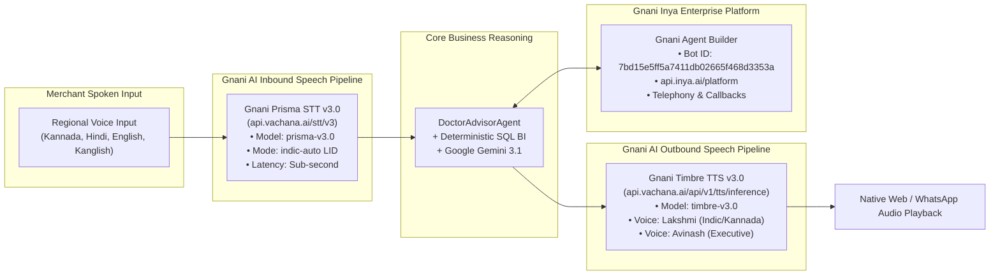
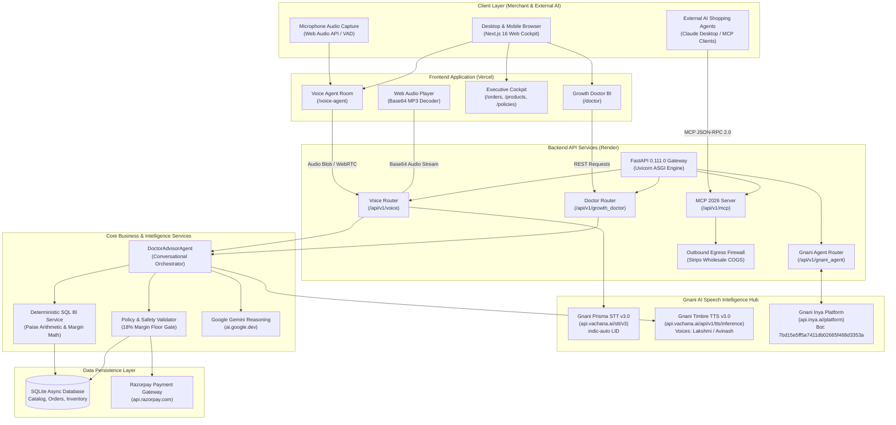
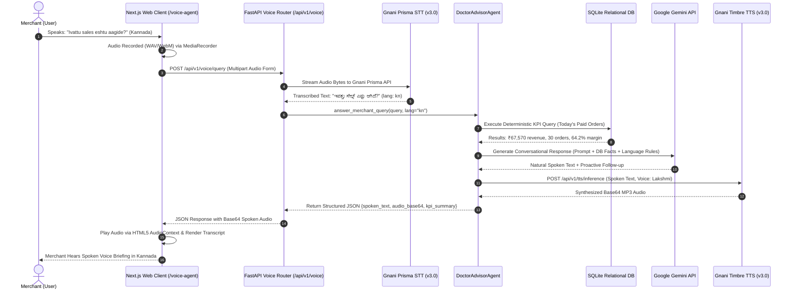

# Vyapar Mitra — Har Dukaan Ka Apna Mitra
### *Autonomous Multilingual Business Growth Agent & Conversational Voice AI Companion for India's Independent Retailers*

[](https://gnani-vyapar-mitra-apps.vercel.app/)
[](https://github.com/bhuvanvokkaliga29/gnani-vyapar-mitra)
[](https://gnani.ai/)
[](https://api.vachana.ai)
[](https://api.vachana.ai)
[](https://api.inya.ai/platform)
[](https://ai.google.dev/)
[](https://nextjs.org/)
[](https://fastapi.tiangolo.com/)

---

## 1. Executive Summary & Problem Statement

Independent retail merchants and small-to-medium enterprises (MSMEs) form the backbone of commerce across India. However, these shop owners face critical operational and structural challenges:

1. **High Marketplace Commissions & Take-Rates:** Dominant e-commerce aggregators (Amazon India, Flipkart, Meesho) levy commissions, closing fees, return penalties, and advertising charges that consume 15% to 40% of gross transaction value compared to direct-to-consumer channels.
2. **Data & Analytics Barriers:** Most small business owners do not employ dedicated business intelligence analysts or financial accountants. Traditional ERP dashboards and spreadsheets are rigid, English-only, and complex to navigate.
3. **Dead Inventory & Margin Erosion:** Without proactive stock monitoring, working capital remains trapped in slow-moving items, while popular SKUs suffer unmonitored stockouts.
4. **Language & Communication Gap:** Merchants routinely think, converse, and negotiate in regional Indian languages (Kannada, Hindi, Telugu, Tamil) and colloquial code-mixed dialects (Kanglish, Hinglish). Conventional software requires text entry and English proficiency.

### The Vyapar Mitra Solution

**Vyapar Mitra ("Every Shop's Companion")** is an autonomous, multilingual conversational voice agent and commercial growth copilot. Designed as an in-house "Business Doctor", Vyapar Mitra enables merchants to speak naturally to their business.

Built upon **Gnani AI's Speech AI Platform (Prisma STT v3.0, Timbre TTS v3.0, and Inya Agent Platform)** and **Google Gemini Reasoning**, Vyapar Mitra accurately transcribes regional speech, computes exact commercial metrics using deterministic arithmetic, resolves inventory risks, models multi-channel profit arbitrage, and answers business queries in spoken regional audio.

---

## 2. Gnani AI Conversational Voice Engine (Prisma STT, Timbre TTS & Inya Platform)

At the heart of Vyapar Mitra is a deep, first-class integration with **Gnani AI**, India's leading conversational Speech AI platform built specifically for Indian languages and accents.



### 1. Gnani Prisma STT (v3.0) — Automatic Speech Recognition
- **Official API Endpoint:** `https://api.vachana.ai/stt/v3`
- **Model:** `prisma-v3.0`
- **Zero-Configuration Language Detection (`indic-auto`):** Dynamically identifies the spoken Indian language (Kannada `kn`, Hindi `hi`, Indian English `en-IN`, and code-mixed Kanglish) without requiring the merchant to manually toggle language switches in the UI.
- **Acoustic Robustness for Indian Retail:** Engineered to tolerate noisy retail shop environments (street traffic, background chatter, ceiling fans) and colloquial spoken patterns (e.g., *"Ivattu sales eshtu aagide?"*, *"Kharche kitna hua?"*, *"Yav SKU reorder madbeku?"*).
- **Domain Entity Extraction:** High-fidelity transcription of currency numbers, units, sizes, and Indian apparel terminology (Linen Shirts, Sarees, Kurtas, Nehru Jackets).

### 2. Gnani Timbre TTS (v3.0) — Neural Speech Synthesis
- **Official API Endpoint:** `https://api.vachana.ai/api/v1/tts/inference`
- **Model:** `timbre-v3.0`
- **Neural Voice Profiles:**
  - **`Lakshmi` (Primary Indic / Kannada Voice):** Delivers natural, warm, and conversational spoken briefings with authentic regional intonation, respectful cadence, and accurate pronunciation of Indian numbering (lakhs, thousands, rupees).
  - **`Avinash` (Executive / Bilingual Voice):** Provides crisp, authoritative executive financial briefings in Indian English and Hindi.
- **Base64 Audio Streaming:** Audio is synthesized directly into high-clarity MP3/WAV streams and returned as base64 payloads to the client for immediate, low-latency browser playback without intermediate buffering stalls.

### 3. Gnani Inya Agent Platform / Agent Builder Integration
- **Platform Base URL:** `https://api.inya.ai/platform`
- **Bot Identifier:** `7bd15e5ff5a7411db02665f468d3353a`
- **Dual-Mode Orchestration:** The backend (`apps/api/routers/gnani_agent.py` and `apps/api/routers/voice.py`) supports dual execution:
  - **Fast-Doctor Mode:** Directly couples Gnani Prisma STT $\rightarrow$ Deterministic BI $\rightarrow$ Gemini Reasoning $\rightarrow$ Gnani Timbre TTS for ultra-low latency interactive dialogue.
  - **Agent Builder Mode:** Routes calls through the enterprise Gnani Inya platform for structured conversational workflows, multi-clerk routing, and outbound telephony callback sessions (`MerchantCallbackRequest`).

---

## 3. Key Features & Capabilities

### Real-Time Conversational Voice Companion
- **Multilingual Code-Switching:** Seamlessly understands and responds in **Kannada, Hindi, English**, and mixed speech (**Kanglish**, Hinglish) without requiring manual language toggling.
- **Low-Latency Speech Processing:** Fast audio chunk streaming with sub-second speech transcription via Gnani Prisma STT v3.0.
- **Natural Neural Spoken Audio:** Synthesizes clear, regional spoken responses via Gnani Timbre TTS v3.0 using the `Lakshmi` (Kannada/Indic) and `Avinash` (Executive) neural voices.
- **Context-Aware Turn-Taking & Interruption:** Maintains conversational flow, resolves multi-turn pronouns (*"What is its profit margin?"*), and recovers gracefully from pauses and speech interruptions.

### Deterministic Financial & Commercial Intelligence
- **Zero Financial Hallucination:** Numerical computations (daily revenue, gross margin, net profit, holding cost, and reorder levels) are executed by deterministic SQL and Python services in integer paise (1 INR = 100 paise). The LLM is strictly used for conversational explanation and advice formatting.
- **12 Verified Commercial Diagnostic Areas:**
  1. *Today's Sales & Paid Transactions*
  2. *Total Cumulative Revenue*
  3. *Gross Profit vs. Net Margin*
  4. *Top-Selling Products by Volume & Revenue*
  5. *Critical Low-Stock & Out-of-Stock Warnings*
  6. *Recommended Reorder Quantities*
  7. *Operating Costs, Spend & COGS*
  8. *Period-over-Period Performance (Today vs. Yesterday)*
  9. *Monthly Financial Performance*
  10. *Slow-Moving & Dead Inventory Diagnostics*
  11. *Store-Level and SKU-Level Margin Percentages*
  12. *Total Trapped Inventory Valuation*

### Multi-Channel Profit Arbitrage
- **Channel Unit Economics:** Computes realized net contribution after platform commission, fixed closing fees, forward logistics, reverse logistics (RTO), and ad spend.
- **Direct WhatsApp & ONDC Arbitrage:** Demonstrates exact profit gains from shifting repeat buyers from marketplaces (Amazon/Flipkart) to Direct WhatsApp and ONDC open networks.

### Autonomous Policy Governance & Safety Gates
- **Margin Floor Protection:** Enforces non-negotiable policy constraints (minimum 18.00% gross margin floor, maximum 20.00% discount ceiling, integer inventory locking).
- **Single-Use Execution Leases:** Price changes and promotional bundles require single-use HMAC-SHA256 authorization tokens with 15-minute expiration windows.
- **Model Context Protocol (MCP 2026):** Exposes catalog and checkout tools to external AI shopping agents while enforcing a strict outbound data firewall to safeguard wholesale COGS.

---

## 4. Technology Stack

| Layer | Technology | Details / Purpose |
|---|---|---|
| **Speech-to-Text (STT)** | **Gnani AI Prisma STT v3.0** | Official low-latency speech recognition with `indic-auto` language identification and retail acoustic tuning. |
| **Text-to-Speech (TTS)** | **Gnani AI Timbre TTS v3.0** | Neural multi-speaker speech synthesis featuring `Lakshmi` (Kannada/Indic) and `Avinash` (Executive) voices. |
| **Enterprise Speech Bot** | **Gnani Inya Platform** | Agent Builder Bot (`7bd15e5ff5a7411db02665f468d3353a`) for enterprise telephony and multi-turn workflows. |
| **Conversational LLM** | **Google Gemini API** | Structured reasoning (`gemini-3.1-flash-lite-preview` / `gemini-flash-lite-latest`) with deterministic heuristic fallbacks. |
| **Frontend Framework** | **Next.js 16.3.4 (App Router)** | High-performance React 19 framework utilizing Turbopack for sub-second builds. |
| **Styling & Icons** | **Tailwind CSS 4, Lucide React** | High-contrast dark-mode design tokens and accessible retail iconography. |
| **Backend Framework** | **FastAPI 0.111.0 (Python 3.11+)** | Asynchronous ASGI REST API framework with Pydantic v2 data validation. |
| **Database & ORM** | **SQLite / aiosqlite, SQLAlchemy 2.0** | Asynchronous relational persistence with foreign-key tenant isolation. |
| **Payment Integration** | **Razorpay Test Mode** | Verified order creation, webhook handling (`payment.captured`), and HMAC verification. |
| **Protocol Standards** | **Anthropic MCP (2026 Spec)** | Standards-compliant Model Context Protocol server exposing catalog tools. |
| **Cloud Hosting** | **Vercel (Frontend), Render (Backend)** | Globally distributed frontend CDN connected to containerized Python API. |

---

## 5. System Architecture



---

## 6. Conversational Voice Pipeline & Execution Flow



---

## 7. Database & Demonstration Dataset (Vastram Boutique)

Vyapar Mitra includes a reproducible retail dataset seeded via `scripts/seed_vastram_dataset.py`.

- **Demonstration Merchant:** Vastram Ethnic Apparel (`merch_atlas_travel`).
- **Product Catalog:** 64 apparel SKUs spanning Linen Shirts, Silk Sarees, Nehru Jackets, Chinos, and Kurtas.
- **Historical Orders:** 340+ historical transactions spanning a 30-day window.
- **Milestone Day Figures:**
  - Daily Revenue: ₹67,570.00 across 30 verified paid orders.
  - Active Gross Margin: ~64.5%.
  - Critical Stock Alerts: Identifies low-stock items (e.g., *Black Formal Trousers* with $\le 5$ units).
  - Trapped Working Capital: Identifies dead stock items (e.g., *Charcoal Grey Trousers* dormant for $>60$ days).

---

## 8. Repository Structure

```text
gnani-vyapar-mitra/
├── apps/
│   ├── api/                          # FastAPI Backend Application
│   │   ├── core/                     # Configuration, Database, Security Middleware
│   │   │   ├── config.py             # Pydantic Settings & Environment Parsing
│   │   │   ├── database.py           # Async SQLAlchemy Engine & Session Factory
│   │   │   └── middleware.py         # Request ID, Logging, and CORS Configuration
│   │   ├── routers/                  # Modular REST API Route Handlers
│   │   │   ├── voice.py              # Voice Processing, STT & TTS Endpoints
│   │   │   ├── gnani_agent.py        # Gnani Agent Builder & Platform Endpoints
│   │   │   ├── growth_doctor.py      # Business Intelligence & Diagnostics Routes
│   │   │   ├── orders.py             # Order Ledger & Transaction Queries
│   │   │   ├── merchants.py          # Multi-Tenant Merchant Profiles
│   │   │   ├── mcp.py                # Model Context Protocol (MCP 2026) Endpoints
│   │   │   ├── whatsapp.py           # WhatsApp Inbound Gateway & Webhook Handlers
│   │   │   └── health.py             # Health Checks & Service Readiness Probes
│   │   └── main.py                   # FastAPI Application Entrypoint & Lifecycle
│   └── web/                          # Next.js 16 Web Dashboard Application
│       ├── src/
│       │   ├── app/                  # Next.js App Router Pages
│       │   │   ├── page.tsx          # Executive KPI Cockpit Overview
│       │   │   ├── voice-agent/      # Conversational Voice Agent Interface
│       │   │   ├── doctor/           # Growth Doctor Diagnostics & Analytics
│       │   │   ├── orders/           # Order Ledger & Payment Tracking
│       │   │   ├── products/         # Catalog & Inventory Margin Management
│       │   │   ├── channels/         # Multi-Channel Profit Arbitrage Matrix
│       │   │   ├── policies/         # Commercial Policy Rules & Floor Gates
│       │   │   ├── decisions/        # Autonomous Decision Audit Ledger
│       │   │   └── learning/         # LinUCB Reinforcement Learning Inspection
│       │   ├── components/           # Reusable UI Widgets & Navigation Shell
│       │   └── lib/                  # API Client, TypeScript Interfaces & Context
│       ├── package.json              # Frontend Node Dependencies
│       └── next.config.ts            # Next.js Configuration
├── domain/                           # Relational Models & Schemas
│   ├── models.py                     # Merchant, Product, Order, Payment & Audit Entities
│   └── growth_models.py              # ChannelConfig & Arbitrage Data Models
├── services/                         # Business Logic & External Service Connectors
│   ├── agent/                        # Conversational DoctorAdvisorAgent Orchestrator
│   ├── voice/                        # Gnani Prisma STT & Timbre TTS Implementations
│   ├── llm/                          # Google Gemini & OpenRouter Fallback Clients
│   ├── commerce/                     # Inventory Valuation & Financial Math
│   ├── growth_doctor/                # Dead Stock, Stockout & Margin Diagnostic Services
│   ├── marketplace/                  # Amazon, Flipkart, Meesho, ONDC Economics Engine
│   ├── mcp/                          # FastMCP Server Implementation
│   └── razorpay/                     # Razorpay SDK Client, Order Creation & Webhooks
├── scripts/                          # Seeding & Verification Utilities
│   └── seed_vastram_dataset.py       # Deterministic Vastram Catalog Seeder
├── tests/                            # Automated Pytest Suite
│   ├── unit/                         # Unit Tests (Hermetic In-Memory SQLite)
│   │   ├── test_conversational_intelligence_production.py
│   │   └── test_commercial_questions_suite.py
│   └── conftest.py                   # Pytest Fixtures & Database Setup
├── render.yaml                       # Render Infrastructure-as-Code Blueprint
├── requirements.txt                  # Python Production Dependencies
├── pyproject.toml                    # Python Project Metadata & Build Settings
├── .env.example                      # Documented Environment Variable Template
└── README.md                         # Master Documentation File
```

---

## 9. Local Installation & Setup Guide

### Prerequisites
- **Python:** 3.11.0 or higher
- **Node.js:** 18.18.0 or higher (Node 20+ recommended)
- **Git**

### Step 1: Clone the Repository
```bash
git clone https://github.com/bhuvanvokkaliga29/gnani-vyapar-mitra.git
cd gnani-vyapar-mitra
```

### Step 2: Configure Environment Variables
Create a local `.env` file based on `.env.example`:
```bash
cp .env.example .env
```
*(Populate your API keys as described in Section 10 below).*

### Step 3: Set Up Backend (FastAPI)
```bash
# Create and activate virtual environment
python -m venv .venv

# On Windows (PowerShell):
.venv\Scripts\Activate.ps1
# On Linux/macOS:
# source .venv/bin/activate

# Install dependencies in editable mode
pip install -r requirements.txt
pip install -e .

# Seed the Vastram boutique dataset
python scripts/seed_vastram_dataset.py

# Launch FastAPI server on port 8000
python -m uvicorn apps.api.main:app --host 127.0.0.1 --port 8000 --reload
```
The backend will be available at `http://127.0.0.1:8000`. You can test health at `http://127.0.0.1:8000/health`.

### Step 4: Set Up Frontend (Next.js)
In a new terminal window:
```bash
cd apps/web
npm install
npm run dev
```
The Next.js dashboard will be available at `http://localhost:3000`.

---

## 10. Environment Variable Reference

The application uses environment variables for external service integration. Store these in your local `.env` file or in your cloud deployment platform's secret manager:

| Environment Variable | Description | Safe Placeholder |
|---|---|---|
| `APP_ENV` | Application environment (`development` or `production`) | `production` |
| `DATABASE_URL` | SQLAlchemy async database connection string | `sqlite+aiosqlite:///./test.db` |
| `GNANI_SPEECH_API_KEY` | Gnani AI Speech Platform API Key (Prisma STT & Timbre TTS) | `your_gnani_speech_key` |
| `GNANI_API_KEY` | Gnani AI Platform API Key | `your_gnani_platform_key` |
| `GNANI_AGENT_ID` | Gnani Inya Agent Bot Identifier | `7bd15e5ff5a7411db02665f468d3353a` |
| `GNANI_BASE_URL` | Gnani Speech API Base URL | `https://api.vachana.ai` |
| `GNANI_PLATFORM_BASE_URL` | Gnani Inya Platform Base URL | `https://api.inya.ai/platform` |
| `GEMINI_API_KEY` | Google AI Studio Gemini API Key | `your_gemini_api_key` |
| `GEMINI_MODEL` | Gemini model variant | `gemini-3.1-flash-lite-preview` |
| `OPENROUTER_API_KEY` | Optional fallback LLM provider key | `your_openrouter_key` |
| `RAZORPAY_KEY_ID` | Razorpay Test Key ID | `rzp_test_your_key_id` |
| `RAZORPAY_KEY_SECRET` | Razorpay Secret Key | `your_razorpay_secret` |
| `WHATSAPP_TEST_MERCHANT_PHONE` | Authorized merchant telephone for whitelisted gateway | `+919113960498` |
| `WHATSAPP_DEFAULT_MERCHANT_ID` | Default tenant identifier | `merch_atlas_travel` |
| `NEXT_PUBLIC_API_URL` | Public API URL accessed by frontend (in `apps/web/.env.local`) | `http://localhost:8000` |

---

## 11. Cloud Deployment Guide

The application is deployed across **Vercel** (Frontend) and **Render** (Backend).

### 1. Frontend Deployment on Vercel
- **Repository:** `https://github.com/bhuvanvokkaliga29/gnani-vyapar-mitra`
- **Root Directory:** Set strictly to `apps/web` (since the repository is a monorepo).
- **Framework Preset:** Next.js (automatically detected).
- **Build Command:** `next build` (or `npm run build`).
- **Environment Variables:**
  - `NEXT_PUBLIC_API_URL`: Set to your live Render backend URL (e.g., `https://vyapar-mitra-api.onrender.com` without a trailing slash).

### 2. Backend Deployment on Render
- **Service Type:** Web Service
- **Runtime:** Python 3.11.9
- **Build Command:**
  ```bash
  pip install -r requirements.txt && pip install -e . && python scripts/seed_vastram_dataset.py
  ```
- **Start Command:**
  ```bash
  uvicorn apps.api.main:app --host 0.0.0.0 --port $PORT
  ```
- **Environment Variables:**
  Add the backend environment variables specified in Section 10 (`GNANI_SPEECH_API_KEY`, `GNANI_API_KEY`, `GNANI_AGENT_ID`, `GEMINI_API_KEY`, `DATABASE_URL`, `PYTHON_VERSION=3.11.9`, etc.).

---

## 12. Automated Testing & Verification

The repository maintains an automated unit and commercial verification test suite:

```bash
# Run conversational intelligence and commercial questions test suite
pytest tests/unit/test_conversational_intelligence_production.py tests/unit/test_commercial_questions_suite.py -v
```

### Verified Test Cases
- **Conversational Intelligence:** Validates ambiguity handling, multi-turn pronoun retention, code-switching in Kannada and Hindi, mathematical error correction, and strict merchant tenant isolation.
- **12 Commercial Questions:** Independently calculates SQL ground truth and compares against the Doctor Advisor agent's spoken responses for revenue, profit margins, stock reordering, slow-moving items, and inventory valuation.

---

## 13. Future Roadmap

- **Autonomous Supplier WhatsApp PO Generation:** Automatically draft and dispatch purchase orders to fabric suppliers when stock hits critical reorder levels.
- **Voice Fingerprinting & Multi-Clerk Security:** Authenticate the store owner versus sales staff by voice biometric signature before approving pricing overrides.
- **Direct Beckn / ONDC Network Adapter:** Live catalog publishing and order intake via ONDC open retail protocols.
- **Low-Power On-Device Edge VAD:** Running lightweight WebAssembly voice activity detection locally in browser storage to reduce network traffic.

---

## 14. Project Links & Acknowledgements

- **Live Application:** [https://gnani-vyapar-mitra-apps.vercel.app/](https://gnani-vyapar-mitra-apps.vercel.app/)
- **GitHub Repository:** [https://github.com/bhuvanvokkaliga29/gnani-vyapar-mitra](https://github.com/bhuvanvokkaliga29/gnani-vyapar-mitra)
- **Speech Intelligence:** Built using [Gnani.ai](https://gnani.ai) Prisma Speech-to-Text (v3.0), Timbre Text-to-Speech (v3.0), and Inya Agent Platform.
- **Reasoning Infrastructure:** Powered by [Google Gemini](https://ai.google.dev/).
- **Commerce Infrastructure:** Integrated with [Razorpay](https://razorpay.com).

*Vyapar Mitra — Har Dukaan Ka Apna Mitra. Empowering India's Retailers with Voice and Commerce AI.*
